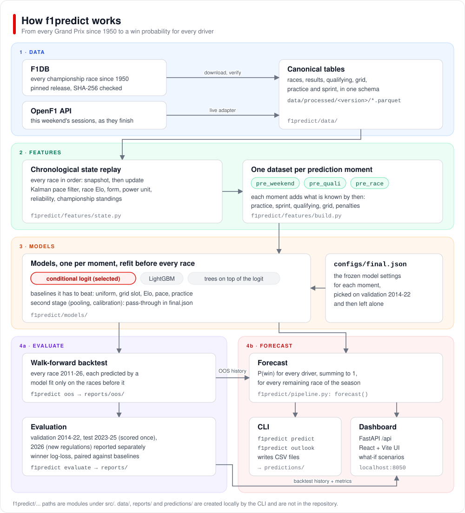

# f1predict

Who wins the next Grand Prix? f1predict gives every driver on the grid a probability of winning, and
comes with a local web dashboard for exploring the forecasts.

## Why I built this

I wanted to get more of an understanding of machine learning, and I love F1, so I thought: what better
way to learn than to build a model that predicts Formula 1 race winners? The inspiration came from
Mariana Antaya ([@mar_antaya](https://www.instagram.com/mar_antaya/) on Instagram), who posts
machine-learning predictions before each race and shares the code in
[mar-antaya/2025_f1_predictions](https://github.com/mar-antaya/2025_f1_predictions).

F1 also suits this kind of project. There is a public record of every championship race since 1950, and
every race weekend ends with one clear answer to check a forecast against.

So the question I set out to answer was: before a race, how likely is each driver to win it?

## What I built

f1predict answers that question with a probability for every driver, adding up to 1 across the field,
at three points of a race weekend:

| moment | when | what the model knows |
|---|---|---|
| `pre_weekend` | days or weeks before | everything up to the previous race |
| `pre_quali` | after practice | plus practice (and on 2024+ sprint weekends, sprint qualifying and the sprint) |
| `pre_race` | after qualifying | plus qualifying, the starting grid, penalties and pit-lane starts |

Forecasts are scored with winner log-loss: the negative log of the probability the model gave to the
driver who actually won. Lower is better, and a uniform guess scores about 3.0.

It came together in ten steps, in the order they happened.

### 1. A plan, and a review of it

I wrote the plan down before any code: what to predict at which moment, and how the seasons would be
split for choosing and testing models. A review of that plan, which ran while the first code was being
written, changed 13 decisions. One of them was a leak of exactly the silent kind (step 3 explains why
leaks are silent). F1DB has no session timestamps before 2024, and on the 2021-23 sprint weekends the
sprint ran after Grand Prix qualifying. Assuming the sprint always comes before qualifying, as it has
since 2024, would have leaked sprint results into 12 races, so the session order is written out for every
weekend format. Another change was to fit the second stage (a layer that pools and recalibrates the
models) walk-forward: fitted in-sample it looked better (-0.013 log-loss), and fitted walk-forward it
gained nothing (0.000).

### 2. Getting the data

The history comes from [F1DB](https://github.com/f1db/f1db): every championship race since 1950 with
results, qualifying segments, starting grids, practice and sprint sessions. The release is pinned and its
SHA-256 checksum is checked on download, then everything is loaded into one set of canonical tables.

Old racing data has its quirks. Teams get renamed and rebranded, so the 1950s Alfa Romeo has to be kept
apart from the 2019 one. Fixes like that went into the tables, and the code review in step 5 caught a few
more.

### 3. Keeping the future out

Leaving out next week's results is the easy part. Every race is also a training row for later races and
an input to their features, so each number the model sees has to be recomputed as it stood at the moment
that forecast would have been made. The only sign of a leak is scores that look better than they should.

So the core of the project is a replay of the calendar in order: 1,155 completed races, plus the 6 still
to come in 2026. Before each race the engine takes a snapshot of every entrant's features, and only then
updates its state with the result.

### 4. Features, models and a first tuning run

The core signal is qualifying pace. Each team's gap to pole goes through a Kalman filter, with more noise
early in a season and a pull back toward the field at the start of every season, strongest at the major
regulation resets (2009, 2014, 2022 and 2026). Driver offsets come from comparing teammates in the same
session. Around that sit a race Elo rating (mechanical failures do not count against the driver), recent
form, power-unit pace and reliability, and the championship standings. Each moment then adds its own
weekend information: practice gaps, the sprint, the qualifying gap, the grid slot and penalties.

Every model had to beat simple baselines first, from a uniform guess up to the historical win rate of
each grid slot. The main candidate was a conditional logit, McFadden's choice model with one softmax per
race. Against it I tried LightGBM with a custom per-race softmax objective, a rank-ordered (Plackett-Luce)
version, recency weighting, and a second stage that pools models and recalibrates them.

Every candidate is scored walk-forward: before each race it is refit on earlier races only, and then
predicts that race. The 2014-22 seasons are for validation, where every choice gets made. The 2023-25
seasons are the test set, left untouched until the end, and 2026 is reported on its own because of the
new regulations.

Once the models and the backtest worked, I added a mutation test that scrambles every result from race r
onward and checks that race r's features do not change. Then came a first tuning run on the validation
seasons. While it ran, I added an adapter that pulls a weekend still in progress from the
[OpenF1](https://openf1.org) API into the same tables, so a live forecast goes through exactly the same
code as the backtest.

### 5. The code review, and the hardest part

The code review ran alongside that first tuning run, before anything was frozen, and it showed what the
hardest part really was: measuring pace correctly across more than 75 years of messy data. Of its 17
bugs, 2 were leaks in forecasts several races ahead (one fitted on races that had not happened yet, one
used line-ups nobody knew yet), and 2 were in how forecasts were scored. Of the other 13, 11 were in the
pace maths or the data.

The filter that compares teammates was about 2.6 times overconfident, and a leftover constant put
Mercedes' team pace 0.44% slower than the average of its own drivers, when the two should agree. On the
data side, three 1950s races still had two winners, because two drivers had shared a car and both got
credit for the win.

One of the pace bugs was in the qualifying gap. The gap to pole is stitched across Q1, Q2 and Q3 so that
a driver knocked out in Q1 can still be compared with the one on pole: each driver is measured in the
last segment they set a time in, then shifted onto the later segments' scale by the offset between
segments. The first version used the largest offset, so a single wet lap pushed every eliminated driver
to the maximum gap; it now uses the median.

### 6. Final tuning and freezing

With the bugs fixed, the final tuning ran on the validation seasons only, first for the feature and state
settings, then for the models, this time with a hybrid in the running (shallow trees on top of the
logit's scores). The plain conditional logit won. It had the best validation score at all three moments,
and the selection rule favoured simple models anyway: a more complex one would only have been picked if
it was clearly better. The choice was frozen in `configs/final.json`.

### 7. Scoring the test seasons, once

Only then was the frozen model scored on the 2023-25 test seasons, a single time. Apart from the
in-sample figure in step 1, every score in this README is out-of-sample. Δ is the race-paired difference
to the strongest simple model for that moment, with a 95% bootstrap interval.

| moment | log-loss | simple model | Δ [95% CI] | seasons better | favourite won | winner in top 3 |
|---|---|---|---|---|---|---|
| `pre_weekend` | 1.428 | pace-only 1.564 | -0.137 [-0.247, -0.025] | 3 / 3 | 44% | 83% |
| `pre_quali` | 1.497 | pace-only 1.564 | -0.067 [-0.227, +0.120] | 2 / 3 | 47% | 80% |
| `pre_race` | 1.118 | grid-slot prior 1.439 | -0.322 [-0.687, -0.030] | 2 / 3 | 63% | 89% |

The probabilities are about as sharp as they should be: the best-fitting temperature, where 1 means
neither too confident nor too timid, is between 0.91 and 1.05 on validation and test. Looking further
ahead costs accuracy, from 1.42 one race ahead to 1.58 six races ahead.

Sticking to the frozen choice has a cost. On the test seasons LightGBM did score better than the logit
after practice (1.393 vs 1.497) and after qualifying (1.058 vs 1.118). Switching to it now would mean
choosing on the test set, so the logit stays.

Splitting the test scores by weekend type showed where the model struggles most: sprint weekends. On a
standard weekend each new session helps, as it should: test log-loss goes from 1.446 before the weekend
to 1.366 after practice and 0.925 after qualifying. On the 18 sprint weekends of 2023-25 it goes the
other way. The after-practice model scores 1.876 and the after-qualifying model 1.673, both worse than
the 1.374 of the forecast made before the weekend. Since 2024 the sprint runs before qualifying, a format
the model had almost no history of, and it trusts the sprint result too much. Until a fix is tested on
new races, use the `pre_weekend` forecast on sprint weekends.

The 2026 season, with new regulations, is the other weak spot. After qualifying the model scores better
than the grid prior (1.278 vs 1.420, though over 17 races the interval still includes zero), but it is
under-confident (temperature 0.67), because grid order decides more in this era than history suggests.
Before the weekend it is about level with the pace-only model (1.99 vs 1.93, a difference well inside
the noise).

### 8. The first real forecast

Right after that, the model made its first real forecast, on 2026-10-20 with data up to the Singapore
GP:

```
$ f1predict predict
2026 round 18: austin (2026-10-25), horizon 1
  kimi-antonelli         mercedes        21.9%  █████████
                                                why: t_pts_h3_rel +0.95; d_pace_rel +0.81; t_pace_rel +0.72
  max-verstappen         red-bull        19.5%  ████████
                                                why: rating_rel +0.88; t_pts_h3_rel +0.83; d_pace_rel +0.69
  george-russell         mercedes        16.1%  ██████
                                                why: t_pts_h3_rel +0.95; rating_rel +0.79; d_pace_rel +0.75
  charles-leclerc        ferrari         14.2%  ██████
  lewis-hamilton         ferrari         11.6%  █████
  lando-norris           mclaren          7.9%  ███
  oscar-piastri          mclaren          3.7%  █
  ...
```

### 9. Looking inside it

Writing the project up meant looking at where the signal comes from. To find it, I dropped one feature
group at a time on the validation seasons. Before the weekend, losing the pace filter costs more than
anything else (+0.062 log-loss); after qualifying, losing qualifying and the grid costs +0.126.

### 10. A dashboard on top

The last step was a local web dashboard over the same pipeline, with a FastAPI backend and a React
frontend, for browsing forecasts and running what-if scenarios. The [Dashboard](#dashboard) section
below has the details.

## How it works



The pipeline has four stages, and the diagram shows where each one lives under `src/f1predict/`.

1. Data. `f1predict download` fetches the pinned F1DB release, checks it and writes canonical tables to
   `data/processed/`. The OpenF1 adapter (`data/live.py`) fills the same tables for a weekend in progress.
2. Features. `features/state.py` replays every race in order, snapshot first and update second.
   `features/build.py` turns that state into one dataset per moment.
3. Models. `models/` holds the baselines, the conditional logit, LightGBM and its hybrid (all trained on
   a per-race softmax likelihood) and the second stage. `configs/final.json` fixes the model settings for
   each moment, and its second stage passes the logit through unchanged.
4. Evaluation and forecasting. `f1predict oos` runs the walk-forward backtest and saves out-of-sample
   (OOS) predictions to `reports/oos/`, and `f1predict evaluate` scores them. Forecasts for upcoming races
   refit on every completed race and reuse that out-of-sample history for the second stage, which is why
   `oos` has to run before the first forecast.

## Run it yourself

```bash
uv venv --python 3.12 && uv pip install -e .
source .venv/bin/activate           # Windows: .venv\Scripts\activate
f1predict download                  # pinned F1DB release -> data/raw, canonical tables -> data/processed
f1predict oos                       # walk-forward backtest -> reports/oos (15-20 min; forecasts need it for the second stage)
f1predict predict                   # next race, pre_weekend
f1predict outlook                   # every remaining race of the season
f1predict predict --mode pre_quali --live          # during the weekend, after practice (OpenF1)
f1predict predict --mode pre_race --live           # after qualifying (grid = OpenF1 qualifying order)
f1predict predict --mode pre_race --live --grid-file grid.csv   # + penalties: CSV driver_id,grid_pos[,pit_lane_start]
f1predict evaluate                  # score the backtest -> reports/EVALUATION.md
```

`grid.csv` is a file you write. It adjusts the qualifying order pulled from OpenF1, so it only takes
effect once qualifying has finished; for a fully hand-set grid, use the dashboard.

## Dashboard

```bash
uv pip install -e ".[dashboard]"
cd dashboard && npm install && npm run build && cd ..   # builds the frontend into src/f1predict/dashboard/static
f1predict dashboard                 # http://127.0.0.1:8050 (after `f1predict oos` and `f1predict evaluate`)
```

The Forecast view shows the latest forecast for any remaining race, with the top three feature
contributions behind each driver's probability. Its run form starts a new forecast: pick the race and
the moment, pull this weekend's sessions from OpenF1, set a starting grid by hand (drag to reorder, mark
penalties and pit-lane starts), or swap drivers between seats. Runs execute in the background and are
saved to `predictions/runs/`, and any two runs for the same race can be compared driver by driver. Below
that sits the expected number of wins for each driver over the rest of the season.

The History view puts predictions next to the actual winners for every race from 2014 to 2026, for each
of the three moments. Every one of them is a walk-forward forecast, and the numbers match
`reports/EVALUATION.md`. It has the probability given to each winner against the simple baseline, a
calibration chart, a sortable race table, and a drill-down showing how each race's forecast moved
through the weekend. Forecasts logged before a race (dashboard runs and `f1predict predict` CSVs) are
scored here once the result is in the data.

A hand-set grid has no lap times, so the model sees positions only and its probabilities come out
flatter than with real qualifying; the run says so. A line-up change replays every race since 1950 for
the new field (about 30 s the first time, cached afterwards). After-practice and after-qualifying
forecasts are only offered for the next race, the only one with weekend sessions.

Frontend development: `cd dashboard && npm install && npm run dev` (Vite on :5173, proxying `/api` to
the dashboard server); `npm run test`, `npm run build` (writes `src/f1predict/dashboard/static`).

## Repository layout

```
src/f1predict/
  data/        download (pinned + checksum), canonical tables, OpenF1 live adapter
  features/    state engine (pace filter, Elo, form, reliability), weekend features, dataset builder
  models/      baselines, conditional logit + LightGBM (per-race softmax), online second stage
  evaluation/  walk-forward backtest, metrics, paired comparisons, calibration, report rendering
  dashboard/   FastAPI app + service for the web dashboard (static/ = built frontend, generated)
  pipeline.py  OOS predictions -> second stage -> evaluation -> forecasting
  cli.py       `f1predict` command
dashboard/     React + Vite + Tailwind frontend (API contract: src/api/types.ts)
configs/       final.json (frozen configuration)
assets/        architecture diagram
```

Created locally by the commands above (not in the repository): `.venv/`, `dashboard/node_modules/`,
`src/f1predict/dashboard/static/` (built frontend), `data/` (F1DB tables), `reports/` (backtest
predictions, EVALUATION.md, evaluation.json, figures) and `predictions/` (forecasts from the CLI;
`runs/` holds forecasts run in the dashboard).

## Limitations

* There is no bookmaker-odds benchmark (no free historical source), and the model knows nothing about
  weather, tyre strategy or long-run pace from telemetry.
* 2026 is a new-regulation season with 17 completed races. Its numbers are descriptive, and the design
  process was aware of how 2026 had gone so far, so it is not a clean holdout. The 2023-25 test seasons
  are.
* Multi-race-ahead forecasts assume today's line-ups. To change one race's line-up, run
  `f1predict predict --round N --entry-file lineup.csv` (CSV `driver_id,team_id,engine_id`) or swap
  seats in the dashboard; `f1predict outlook` always uses the current line-ups.
